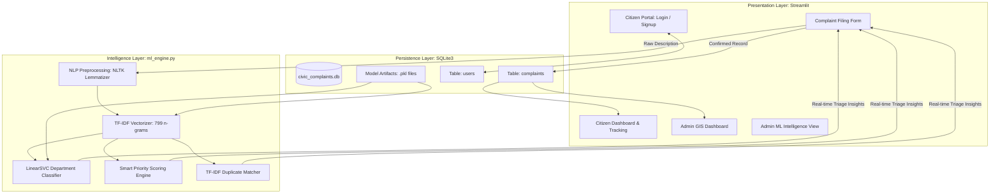
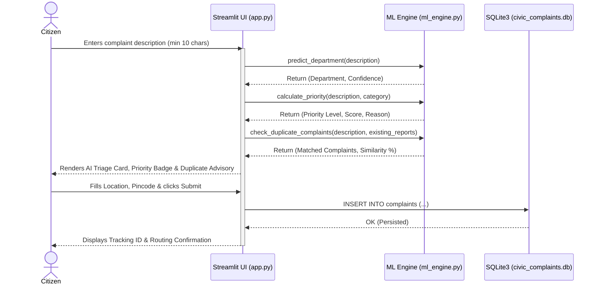

# SYSTEM ARCHITECTURE & DATA FLOW
**Project Name:** AI-Powered Civic Complaint Intelligence System  
**Date:** October 29, 2026  

---

## 1. Architectural System Overview

The application follows a modular, three-tier architecture combining a reactive user interface, an intelligent machine learning inference engine, and an ACID-compliant local relational database.

---

## 2. Component Layer Breakdown

### Layer 1: Presentation Tier (`app.py`)
- **Framework:** Streamlit (Python 3.13)
- **Role Management:**
  - **Citizen View:** Protected by citizen login/signup. Allows submitting grievances with multi-format media attachments (jpg, png, mp4) and viewing historical ticket updates.
  - **Administrator View:** Protected by admin credentials. Offers inline interactive status editing (`st.data_editor`), spatial GIS summaries, timeline analytics, and direct model diagnostic inspection.
- **State Management:** Reactive execution driven by `st.session_state` with dynamic data synchronization to SQLite.

### Layer 2: Machine Learning Intelligence Tier (`ml_engine.py`)
- **Design Pattern:** Singleton Engine Pattern (`ml_engine = MLEngine()`).
- **Cold-Start Handling:** Caches the serialized `LinearSVC` classifier and `TfidfVectorizer` in memory on first invocation, ensuring zero-latency inference ($\sim 2.2\text{ ms}$) on subsequent requests.
- **Inference Pipelines:**
  1. **Department Routing:** Transforms cleaned input into 799-dimensional TF-IDF space and evaluates margin distances across all 8 municipal departments.
  2. **Smart Prioritization:** Computes multi-factor hazard scores (1.0 to 10.0 scale) and outputs human-readable rationales.
  3. **Duplicate Detection:** Computes cosine similarity across stored complaint descriptions, flagging potential duplicate tickets ($>45\%$ match).

### Layer 3: Persistence Tier (`civic_complaints.db`)
- **Database Engine:** SQLite3 with foreign-key support and ACID guarantees.
- **Relational Tables:**
  - `complaints`: Primary transaction table storing complaints, media attachments, GIS coordinates, AI-predicted departments, priority metrics, and duplicate links.
  - `users`: User authentication table supporting persistent citizen registration and administrative credentials.

---

## 3. Complaint Submission Sequence Flow

---

## 4. Machine Learning Training Pipeline (`train_models.py`)

The offline training and benchmarking pipeline operates independently of the web application:

1. **Ingestion:** Loads `dataset/municipal_training_set_1100.csv` (1,100 records).
2. **Label Standardization:** Maps 25 micro-classes into 8 documented municipal departments.
3. **Data Leakage Elimination:** Deduplicates identical text complaints, leaving 439 unique samples.
4. **Stratified Split:** Divides into 80% Training ($N=351$) and 20% Testing ($N=88$) with fixed seed (`random_state=42`).
5. **Feature Engineering:** Fits TF-IDF on $X_{train}$ only (Unigrams + Bigrams, $\text{min\_df}=2$, sublinear TF scaling).
6. **Model Benchmarking:** Fits and benchmarks 4 algorithms:
   - Majority-Class Baseline
   - Multinomial Naive Bayes
   - Multinomial Logistic Regression
   - Linear Support Vector Machine (`LinearSVC`)
7. **Artifact Export:** Serializes winning model to `civic_model.pkl`, vectorizer to `tfidf_vectorizer.pkl`, metrics to `model_comparison.csv`, and confusion matrices to `confusion_matrices.json`.
